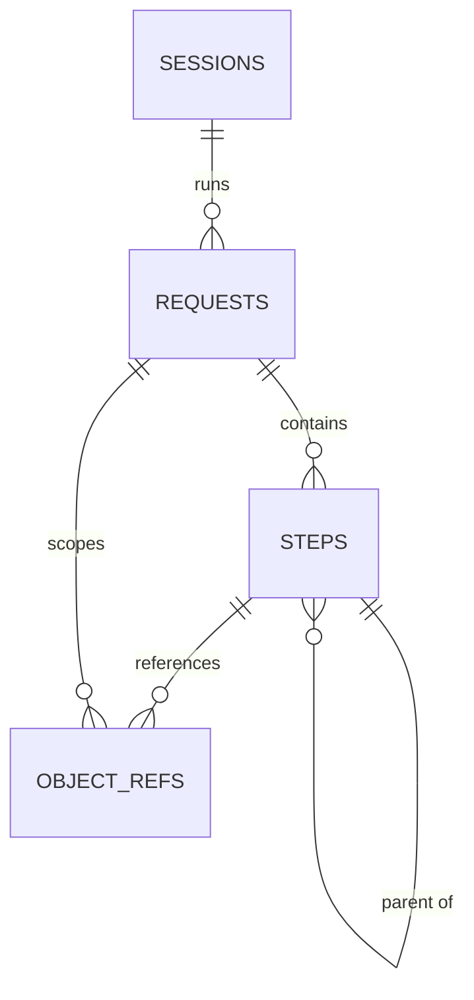

# Pathlight Tracker: Data Model

Pathlight Tracker stores traced requests in **one local SQLite file** (`.pathlight-tracker/traces.db`), owned by the collector. This document defines every table, field, key, index, enum, timestamp rule, access rule and the seed data.

Related docs: `tracer-architecture.md` (event flow, API), `tracer-tech-stack.md` (SQLite, `better-sqlite3`, Drizzle ORM).

---

## 0. Checklist at a glance

| Checkpoint | Where |
| --- | --- |
| Every table listed | §1 |
| Fields with types, required/optional, defaults | §3 |
| Primary and foreign keys | §3, §4 |
| Relationships | §4 |
| Indexes and unique constraints | §5 |
| Enums / allowed values | §6 |
| Timestamps and soft-delete rule (soft delete on `requests`, trash with 72-hour purge) | §7 |
| Access rules | §8 |
| Sample / seed data | §10 |

---

## 1. Tables

| Table | One row per | Phase |
| --- | --- | --- |
| `sessions` | Node process the agent ran in (each app start or restart) | MVP |
| `requests` | Traced request (one map) | MVP |
| `steps` | Step in a request: function call, framework step, boundary call, decision or loop summary | MVP (decision and loop rows from v1) |
| `object_refs` | Appearance of a captured object in a step (argument, return value, `this`, thrown) | Written from MVP, read by the data journey in v2 |
| `meta` | Key/value setting or schema info for the database | MVP |

There is no `users` table: Pathlight Tracker is a single-developer, local-only tool with no accounts.

`requests` supports **soft delete** (a trash the developer can restore from); trashed requests are permanently purged after a grace period. See §7.

---

## 2. Conventions

| Topic | Rule |
| --- | --- |
| IDs | Prefixed ULIDs stored as `TEXT` (sortable by creation time): `ses_…`, `req_…`, `stp_…` |
| Booleans | `INTEGER` `0` / `1` (SQLite has no boolean type) |
| Enums | `TEXT` with a `CHECK (… IN (…))` constraint |
| JSON | `TEXT` holding JSON, validated by Zod before insert |
| Wall-clock times | `INTEGER` Unix epoch **milliseconds**, UTC |
| Durations and offsets | `INTEGER` **nanoseconds** (SQLite 64-bit integers fit ~292 years of nanoseconds) |
| Names | Tables and columns in `snake_case`; Drizzle maps them to `camelCase` in TypeScript |
| Foreign keys | Enforced: `PRAGMA foreign_keys = ON` at every connection |
| Journal mode | `PRAGMA journal_mode = WAL` for fast concurrent reads while ingesting |

---

## 3. Fields

### 3.1 `sessions`

One row per Node process that loaded the agent. A `nest start --watch` restart creates a new session.

| Field | Type | Required | Default | Notes |
| --- | --- | --- | --- | --- |
| `id` | TEXT | Yes | ULID `ses_…` | **PK** |
| `pid` | INTEGER | Yes | — | OS process id |
| `command` | TEXT | No | `NULL` | User command, e.g. `npm run start:dev` |
| `cwd` | TEXT | Yes | — | Project root |
| `node_version` | TEXT | Yes | — | e.g. `v24.10.0` |
| `agent_version` | TEXT | Yes | — | e.g. `0.1.0` |
| `protocol_version` | INTEGER | Yes | — | Must match collector major |
| `framework` | TEXT | Yes | `'unknown'` | Enum `framework` |
| `status` | TEXT | Yes | `'connected'` | Enum `session_status` |
| `disabled_reason` | TEXT | No | `NULL` | Set when the agent auto-disables |
| `connected_at` | INTEGER | Yes | — | Epoch ms |
| `disconnected_at` | INTEGER | No | `NULL` | Epoch ms |
| `created_at` | INTEGER | Yes | now | Epoch ms |
| `updated_at` | INTEGER | Yes | now | Epoch ms, set on every update |

### 3.2 `requests`

One row per traced request.

| Field | Type | Required | Default | Notes |
| --- | --- | --- | --- | --- |
| `id` | TEXT | Yes | ULID `req_…` | **PK**; equals the agent's `traceId` |
| `session_id` | TEXT | Yes | — | **FK** → `sessions.id` |
| `method` | TEXT | Yes | — | Enum `http_method` |
| `path` | TEXT | Yes | — | Actual path, e.g. `/orders/42` |
| `route` | TEXT | No | `NULL` | Route pattern, e.g. `/orders/:id` |
| `state` | TEXT | Yes | `'in_progress'` | Enum `request_state` |
| `http_status` | INTEGER | No | `NULL` | Set at `request.end` |
| `has_error` | INTEGER | Yes | `0` | `1` if any error occurred (thrown, swallowed, unhandled) |
| `error_step_id` | TEXT | No | `NULL` | Step where the first error was thrown (not a FK, see §4) |
| `step_count` | INTEGER | Yes | `0` | Steps stored for this request |
| `truncated` | INTEGER | Yes | `0` | `1` if `PATHLIGHT_TRACKER_MAX_STEPS` was hit |
| `request_json` | TEXT | Yes | — | `{ params, query, body, headers }` as captured values, redacted |
| `response_json` | TEXT | No | `NULL` | `{ headers, body }` as captured values, redacted |
| `started_at` | INTEGER | Yes | — | Epoch ms |
| `ended_at` | INTEGER | No | `NULL` | Epoch ms |
| `duration_ns` | INTEGER | No | `NULL` | Total time |
| `deleted_at` | INTEGER | No | `NULL` | Epoch ms when moved to trash; `NULL` = active (soft delete, §7) |
| `created_at` | INTEGER | Yes | now | Epoch ms |
| `updated_at` | INTEGER | Yes | now | Epoch ms |

Check constraint: a request can be soft-deleted only after it has finished (`deleted_at IS NULL OR state <> 'in_progress'`).

### 3.3 `steps`

One row per step in a request. Rows form a tree through `parent_id`.

| Field | Type | Required | Default | Notes |
| --- | --- | --- | --- | --- |
| `id` | TEXT | Yes | ULID `stp_…` | **PK** |
| `request_id` | TEXT | Yes | — | **FK** → `requests.id` |
| `parent_id` | TEXT | No | `NULL` | **FK** → `steps.id`; `NULL` for root steps |
| `seq` | INTEGER | Yes | — | Order of entry within the request, starting at 1 |
| `depth` | INTEGER | Yes | `0` | Tree depth (root = 0) |
| `kind` | TEXT | Yes | — | Enum `step_kind` |
| `name` | TEXT | Yes | — | Display name, e.g. `OrdersService.create` |
| `class_name` | TEXT | No | `NULL` | e.g. `OrdersService` |
| `function_name` | TEXT | No | `NULL` | e.g. `create`; `NULL` for anonymous |
| `file` | TEXT | No | `NULL` | `.ts` path relative to project root (after source maps) |
| `line` | INTEGER | No | `NULL` | 1-based |
| `column` | INTEGER | No | `NULL` | 1-based |
| `is_async` | INTEGER | Yes | `0` | `1` for async functions and promises |
| `status` | TEXT | Yes | `'running'` | Enum `step_status` |
| `args_json` | TEXT | No | `NULL` | Array of captured values |
| `return_json` | TEXT | No | `NULL` | Captured value |
| `this_class` | TEXT | No | `NULL` | Class name of `this`, if any |
| `error_json` | TEXT | No | `NULL` | `{ type, message, stack, file, line }` |
| `error_handling` | TEXT | No | `NULL` | Enum `error_handling`; set when `status = 'threw'` |
| `boundary_type` | TEXT | No | `NULL` | Enum `boundary_type`; required when `kind = 'boundary'` |
| `detail_json` | TEXT | No | `NULL` | Kind-specific detail: boundary request/response, decision values, loop summary |
| `on_error_path` | INTEGER | Yes | `0` | `1` if this step is on the path from root to an error |
| `collapsed_count` | INTEGER | Yes | `1` | > 1 when repeated callbacks are collapsed into one row (v1) |
| `start_offset_ns` | INTEGER | Yes | — | Nanoseconds since request start |
| `duration_ns` | INTEGER | No | `NULL` | Set on exit or throw |
| `created_at` | INTEGER | Yes | now | Epoch ms |
| `updated_at` | INTEGER | Yes | now | Epoch ms |

Check constraints:

- `boundary_type IS NOT NULL` if and only if `kind = 'boundary'`
- `error_handling IS NOT NULL` only when `status = 'threw'`
- `collapsed_count >= 1`, `seq >= 1`, `depth >= 0`

### 3.4 `object_refs`

One row each time a captured object appears in a step. Object IDs are issued by the agent (unique within one session), so they are scoped by `request_id`, which belongs to exactly one session.

| Field | Type | Required | Default | Notes |
| --- | --- | --- | --- | --- |
| `id` | INTEGER | Yes | auto-increment | **PK** |
| `request_id` | TEXT | Yes | — | **FK** → `requests.id` |
| `step_id` | TEXT | Yes | — | **FK** → `steps.id` |
| `object_id` | TEXT | Yes | — | Agent-issued, e.g. `obj_17` |
| `role` | TEXT | Yes | — | Enum `object_role` |
| `path` | TEXT | Yes | `''` | Where inside the value, e.g. `args[0]`, `return.user` |
| `type_name` | TEXT | No | `NULL` | e.g. `User`, `Object`, `Array` |
| `created_at` | INTEGER | Yes | now | Epoch ms |

### 3.5 `meta`

| Field | Type | Required | Default | Notes |
| --- | --- | --- | --- | --- |
| `key` | TEXT | Yes | — | **PK** |
| `value` | TEXT | Yes | — | String or JSON |
| `updated_at` | INTEGER | Yes | now | Epoch ms |

Known keys: `schema_version`, `created_by_version`, `retention_limit`, `trash_ttl_hours`, `last_pruned_at`, `last_trash_purge_at`.

### 3.6 Captured value shape (inside `*_json` columns)

Every captured value uses one shape, so the UI renders all of them the same way:

```ts
type CapturedValue = {
  type: 'string' | 'number' | 'boolean' | 'null' | 'undefined' | 'bigint'
      | 'symbol' | 'function' | 'object' | 'array' | 'map' | 'set'
      | 'date' | 'error' | 'buffer' | 'promise' | 'circular';
  preview: string;             // short display text, e.g. "{ id: 7, tier: undefined }"
  className?: string;          // e.g. "User", "CreateOrderDto"
  objectId?: string;           // e.g. "obj_17" (objects and arrays only)
  size?: number;               // array length / map size / key count
  truncated?: boolean;         // depth, length or size cap hit
  redacted?: boolean;          // value replaced with [REDACTED]
  children?: Record<string, CapturedValue> | CapturedValue[];
};
```

---

## 4. Keys and relationships



| Relationship | Type | Foreign key | On delete |
| --- | --- | --- | --- |
| Session → requests | One-to-many | `requests.session_id` → `sessions.id` | `CASCADE` |
| Request → steps | One-to-many | `steps.request_id` → `requests.id` | `CASCADE` |
| Step → child steps | One-to-many (self, tree) | `steps.parent_id` → `steps.id` | `CASCADE` |
| Step → object refs | One-to-many | `object_refs.step_id` → `steps.id` | `CASCADE` |
| Request → object refs | One-to-many | `object_refs.request_id` → `requests.id` | `CASCADE` |
| Steps ↔ objects | **Many-to-many** (logical) | Through `object_refs`: one object appears in many steps; one step holds many objects | — |
| Request → error step | Reference (not enforced) | `requests.error_step_id` holds a `steps.id` | Cleared by the app if the step is removed |

`error_step_id` is not a declared foreign key because `requests` and `steps` would reference each other, which makes inserts order-dependent. The builder sets it after the step exists, and both are deleted together anyway.

---

## 5. Indexes and unique constraints

| Table | Index / constraint | Type | Serves |
| --- | --- | --- | --- |
| `sessions` | `PRIMARY KEY (id)` | Unique | Lookups |
| `sessions` | `idx_sessions_status (status)` | Index | "Connected agents" in `/api/v1/health` |
| `requests` | `PRIMARY KEY (id)` | Unique | Lookups |
| `requests` | `idx_requests_started_at (started_at DESC)` | Index | Recent requests list, retention pruning |
| `requests` | `idx_requests_session (session_id)` | Index | Requests per session, cascade deletes |
| `requests` | `idx_requests_error (has_error, started_at DESC)` | Index | "Only failed requests" filter |
| `requests` | `idx_requests_route (method, route)` | Index | Filter by endpoint, compare requests (v1) |
| `requests` | `idx_requests_active (started_at DESC) WHERE deleted_at IS NULL` | Partial index | Default request list (active only) and retention count |
| `requests` | `idx_requests_trash (deleted_at) WHERE deleted_at IS NOT NULL` | Partial index | Trash view and the purge job |
| `steps` | `PRIMARY KEY (id)` | Unique | Lookups |
| `steps` | `uq_steps_request_seq UNIQUE (request_id, seq)` | Unique | Ordering; prevents duplicate events |
| `steps` | `idx_steps_parent (request_id, parent_id)` | Index | Loading children lazily |
| `steps` | `idx_steps_error_path (request_id, on_error_path)` | Index | Highlighting the red path |
| `steps` | `idx_steps_name (name)` | Index | Search by function name (v1) |
| `object_refs` | `PRIMARY KEY (id)` | Unique | — |
| `object_refs` | `uq_object_refs UNIQUE (step_id, object_id, role, path)` | Unique | No duplicate references |
| `object_refs` | `idx_object_refs_object (request_id, object_id)` | Index | Data journey: "every step this object passed through" |
| `meta` | `PRIMARY KEY (key)` | Unique | Lookups |

---

## 6. Enums / allowed values

| Enum | Column(s) | Allowed values |
| --- | --- | --- |
| `framework` | `sessions.framework` | `nestjs`, `express`, `unknown` (v2: `fastify`, `nextjs`) |
| `session_status` | `sessions.status` | `connected`, `disconnected`, `disabled` |
| `http_method` | `requests.method` | `GET`, `POST`, `PUT`, `PATCH`, `DELETE`, `HEAD`, `OPTIONS` |
| `request_state` | `requests.state` | `in_progress`, `completed`, `incomplete` (app crashed or restarted mid-request) |
| `step_kind` | `steps.kind` | MVP: `function`, `method`, `middleware`, `guard`, `interceptor`, `pipe`, `handler`, `filter`, `boundary`; v1: `constructor`, `callback`, `decision`, `loop` |
| `step_status` | `steps.status` | `running`, `returned`, `threw` |
| `error_handling` | `steps.error_handling` | `propagated` (passed to caller), `swallowed` (caught and ignored), `converted` (turned into an HTTP response), `unhandled` (unhandled rejection) |
| `boundary_type` | `steps.boundary_type` | MVP: `db`, `http`; v1: `redis`, `queue`, `log`; v2: `fs` |
| `object_role` | `object_refs.role` | `arg`, `return`, `this`, `thrown` |

`detail_json` shapes by kind:

| Kind | `detail_json` |
| --- | --- |
| `boundary` (`db`) | `{ driver, operation, collectionOrTable, query, resultSummary }` |
| `boundary` (`http`) | `{ client, method, url, requestBody, status, responseBody }` |
| `decision` | `{ type, expression, values: { "user.tier": CapturedValue, … }, result, branch }` |
| `loop` | `{ type, iterations, samples: { first, last, failing? } }` |
| `guard` | `{ allowed: boolean }` |
| `pipe` | `{ input: CapturedValue, output: CapturedValue }` |

---

## 7. Timestamps and soft-delete rule

**Timestamps**

| Rule | Detail |
| --- | --- |
| `created_at` on every table except `meta` | Set once on insert by the app (`Date.now()` via Drizzle `$defaultFn`) |
| `updated_at` on every table whose rows change | `sessions`, `requests`, `steps`, `meta`; set on every update via Drizzle `$onUpdate` |
| `object_refs` has no `updated_at` | Rows are never updated, only inserted and deleted |
| Format | Epoch milliseconds, UTC; the API converts to ISO 8601 strings |
| Event timing vs row timing | `started_at`, `ended_at`, `start_offset_ns`, `duration_ns` describe what happened in the app; `created_at` / `updated_at` describe the row itself |

**Soft delete: used for `requests` only, with a time-limited trash and a permanent purge.**

When the developer deletes a request, it moves to the **trash** (`deleted_at` is set). It disappears from the normal views but can be restored. After a grace period, the purge job **permanently deletes** it, so captured values do not live forever.

| Rule | Detail |
| --- | --- |
| Which table | Only `requests` has `deleted_at`. It is the only thing the developer deletes directly. |
| Children | `steps` and `object_refs` have **no** `deleted_at`. They follow their request: hidden while it is trashed, restored with it, and hard-deleted (cascade) when it is purged. One flag, one source of truth. |
| `sessions` | Not soft-deleted. Internal records, hard-deleted when they have no requests left (active or trashed). |
| `meta` | Not soft-deleted. |
| In-progress requests | Cannot be soft-deleted (check constraint); the UI disables delete until the request finishes. |
| Default reads | Every query on `requests` filters `deleted_at IS NULL` unless it explicitly asks for the trash. In Drizzle this is one shared helper (`activeRequests`), so no query forgets it. |
| Steps of a trashed request | The API returns `404 REQUEST_NOT_FOUND` for its steps unless called with `includeDeleted=true` (used by the trash preview). |
| Live updates | Soft-deleting or restoring sends `live.request.deleted` / `live.request.restored` so every open UI updates. |
| Restore | Sets `deleted_at = NULL`. If retention would then exceed the limit, the oldest **active** request is moved to the trash, never purged straight away. |
| Grace period | `PATHLIGHT_TRACKER_TRASH_TTL_HOURS` (default **72 hours**). The purge job hard-deletes requests whose `deleted_at` is older than this. |
| Permanent delete | Explicit "Delete permanently" or "Empty trash" hard-deletes immediately (cascade), skipping the grace period. |
| Privacy | Purged rows are gone; the collector then runs `PRAGMA incremental_vacuum` so deleted values do not linger in free pages of the file. |

How rows are removed:

| Trigger | Type | What happens |
| --- | --- | --- |
| `DELETE /api/v1/requests/:requestId` (UI "Delete") | **Soft** | Sets `deleted_at` on one request |
| `DELETE /api/v1/requests` / `pathlight-tracker clear` (UI "Clear all") | **Soft** | Sets `deleted_at` on all finished active requests |
| `POST /api/v1/requests/:requestId/restore` | Restore | Clears `deleted_at` |
| `DELETE /api/v1/requests/:requestId?permanent=true` | **Hard** | Deletes the request, its steps and object refs immediately |
| `DELETE /api/v1/trash` / `pathlight-tracker clear --purge` (UI "Empty trash") | **Hard** | Deletes every trashed request immediately |
| Purge job (on startup, then hourly) | **Hard** | Deletes trashed requests older than `PATHLIGHT_TRACKER_TRASH_TTL_HOURS` |
| Retention (after each completed request) | **Soft** first | Moves the oldest **active** requests beyond `PATHLIGHT_TRACKER_RETENTION` (default 100) to the trash; the purge job removes them later |
| Trash size guard | **Hard** | If the trash holds more than `PATHLIGHT_TRACKER_RETENTION` requests, the oldest trashed ones are purged early, so the file cannot grow without limit |
| Session cleanup | **Hard** | Disconnected sessions with no remaining requests (active or trashed) |

Example queries:

```sql
-- Default request list (active only)
SELECT * FROM requests WHERE deleted_at IS NULL ORDER BY started_at DESC LIMIT 50;

-- Soft delete one request
UPDATE requests SET deleted_at = :now, updated_at = :now
WHERE id = :id AND deleted_at IS NULL AND state <> 'in_progress';

-- Restore
UPDATE requests SET deleted_at = NULL, updated_at = :now WHERE id = :id;

-- Purge job (steps and object_refs go with it via ON DELETE CASCADE)
DELETE FROM requests WHERE deleted_at IS NOT NULL AND deleted_at < :now - :ttlMs;
```

---

## 8. Access rules

Only the **collector** opens the database. Every other part goes through the collector's API. The database file is created with owner-only permissions (`0600`; `.pathlight-tracker/` folder `0700`).

| Actor | `sessions` | `requests` | `steps` | `object_refs` | `meta` |
| --- | --- | --- | --- | --- | --- |
| Runtime agent | No direct access (sends events) | No direct access | No direct access | No direct access | No direct access |
| Collector ingest | Create, update | Create, update | Create, update | Create | — |
| Collector builder | — | Update (state, status, error fields, counts) | Update (status, error path, durations) | — | — |
| Collector retention job | — | Soft delete (oldest active beyond limit) | — | — | Update |
| Collector purge job | Delete (empty sessions) | Hard delete (trashed past TTL, or trash over limit) | Delete (cascade) | Delete (cascade) | Update |
| Collector REST API | Read (`/health`) | Read active; read trash; soft delete; restore; hard delete (`permanent=true`, empty trash) | Read (only for active requests, or with `includeDeleted=true`) | Read (v2) | — |
| Map UI | Read via API | Read, soft delete, restore, delete permanently, empty trash via API | Read via API | Read via API (v2) | — |
| VS Code extension (Phase 2) | Read via API | Read active via API | Read via API | Read via API | — |
| CLI (`pathlight-tracker clear`) | — | Soft delete all finished requests | — | — | — |
| CLI (`pathlight-tracker clear --purge`) | Delete | Hard delete all (active and trashed) | Delete (cascade) | Delete (cascade) | Update |
| Migrations | Schema only | Schema only | Schema only | Schema only | Create, update `schema_version` |

API calls require the local token and pass origin checks (see `tracer-architecture.md` §4). There are no per-user or per-role rules, because there is only one user.

---

## 9. Schema (SQL)

The Drizzle schema in `packages/collector/src/store/schema.ts` mirrors this SQL; migrations are generated with `drizzle-kit`.

```sql
PRAGMA foreign_keys = ON;
PRAGMA journal_mode = WAL;

CREATE TABLE sessions (
  id               TEXT PRIMARY KEY,
  pid              INTEGER NOT NULL,
  command          TEXT,
  cwd              TEXT NOT NULL,
  node_version     TEXT NOT NULL,
  agent_version    TEXT NOT NULL,
  protocol_version INTEGER NOT NULL,
  framework        TEXT NOT NULL DEFAULT 'unknown'
                   CHECK (framework IN ('nestjs','express','unknown')),
  status           TEXT NOT NULL DEFAULT 'connected'
                   CHECK (status IN ('connected','disconnected','disabled')),
  disabled_reason  TEXT,
  connected_at     INTEGER NOT NULL,
  disconnected_at  INTEGER,
  created_at       INTEGER NOT NULL,
  updated_at       INTEGER NOT NULL
);
CREATE INDEX idx_sessions_status ON sessions (status);

CREATE TABLE requests (
  id             TEXT PRIMARY KEY,
  session_id     TEXT NOT NULL REFERENCES sessions (id) ON DELETE CASCADE,
  method         TEXT NOT NULL
                 CHECK (method IN ('GET','POST','PUT','PATCH','DELETE','HEAD','OPTIONS')),
  path           TEXT NOT NULL,
  route          TEXT,
  state          TEXT NOT NULL DEFAULT 'in_progress'
                 CHECK (state IN ('in_progress','completed','incomplete')),
  http_status    INTEGER,
  has_error      INTEGER NOT NULL DEFAULT 0 CHECK (has_error IN (0,1)),
  error_step_id  TEXT,
  step_count     INTEGER NOT NULL DEFAULT 0,
  truncated      INTEGER NOT NULL DEFAULT 0 CHECK (truncated IN (0,1)),
  request_json   TEXT NOT NULL,
  response_json  TEXT,
  started_at     INTEGER NOT NULL,
  ended_at       INTEGER,
  duration_ns    INTEGER,
  deleted_at     INTEGER,
  created_at     INTEGER NOT NULL,
  updated_at     INTEGER NOT NULL,
  CHECK (deleted_at IS NULL OR state <> 'in_progress')
);
CREATE INDEX idx_requests_started_at ON requests (started_at DESC);
CREATE INDEX idx_requests_session    ON requests (session_id);
CREATE INDEX idx_requests_error      ON requests (has_error, started_at DESC);
CREATE INDEX idx_requests_route      ON requests (method, route);
CREATE INDEX idx_requests_active     ON requests (started_at DESC) WHERE deleted_at IS NULL;
CREATE INDEX idx_requests_trash      ON requests (deleted_at) WHERE deleted_at IS NOT NULL;

CREATE TABLE steps (
  id               TEXT PRIMARY KEY,
  request_id       TEXT NOT NULL REFERENCES requests (id) ON DELETE CASCADE,
  parent_id        TEXT REFERENCES steps (id) ON DELETE CASCADE,
  seq              INTEGER NOT NULL CHECK (seq >= 1),
  depth            INTEGER NOT NULL DEFAULT 0 CHECK (depth >= 0),
  kind             TEXT NOT NULL CHECK (kind IN (
                     'function','method','middleware','guard','interceptor','pipe',
                     'handler','filter','boundary','constructor','callback','decision','loop')),
  name             TEXT NOT NULL,
  class_name       TEXT,
  function_name    TEXT,
  file             TEXT,
  line             INTEGER,
  "column"         INTEGER,
  is_async         INTEGER NOT NULL DEFAULT 0 CHECK (is_async IN (0,1)),
  status           TEXT NOT NULL DEFAULT 'running'
                   CHECK (status IN ('running','returned','threw')),
  args_json        TEXT,
  return_json      TEXT,
  this_class       TEXT,
  error_json       TEXT,
  error_handling   TEXT CHECK (error_handling IN ('propagated','swallowed','converted','unhandled')),
  boundary_type    TEXT CHECK (boundary_type IN ('db','http','redis','queue','log','fs')),
  detail_json      TEXT,
  on_error_path    INTEGER NOT NULL DEFAULT 0 CHECK (on_error_path IN (0,1)),
  collapsed_count  INTEGER NOT NULL DEFAULT 1 CHECK (collapsed_count >= 1),
  start_offset_ns  INTEGER NOT NULL,
  duration_ns      INTEGER,
  created_at       INTEGER NOT NULL,
  updated_at       INTEGER NOT NULL,
  CHECK ((kind = 'boundary') = (boundary_type IS NOT NULL)),
  CHECK (error_handling IS NULL OR status = 'threw'),
  UNIQUE (request_id, seq)
);
CREATE INDEX idx_steps_parent     ON steps (request_id, parent_id);
CREATE INDEX idx_steps_error_path ON steps (request_id, on_error_path);
CREATE INDEX idx_steps_name       ON steps (name);

CREATE TABLE object_refs (
  id          INTEGER PRIMARY KEY AUTOINCREMENT,
  request_id  TEXT NOT NULL REFERENCES requests (id) ON DELETE CASCADE,
  step_id     TEXT NOT NULL REFERENCES steps (id) ON DELETE CASCADE,
  object_id   TEXT NOT NULL,
  role        TEXT NOT NULL CHECK (role IN ('arg','return','this','thrown')),
  path        TEXT NOT NULL DEFAULT '',
  type_name   TEXT,
  created_at  INTEGER NOT NULL,
  UNIQUE (step_id, object_id, role, path)
);
CREATE INDEX idx_object_refs_object ON object_refs (request_id, object_id);

CREATE TABLE meta (
  key        TEXT PRIMARY KEY,
  value      TEXT NOT NULL,
  updated_at INTEGER NOT NULL
);
```

---

## 10. Sample / seed data

The seed reproduces the failing `POST /orders` example from the PRD: a NestJS app where `UserService.findById` returns a user without `tier`, and `PricingService.calculateDiscount` throws. It lives in `fixtures/seed/sample.sql` and loads with `pnpm seed`, so the UI can be built and tested without running a traced app.

```sql
INSERT INTO meta (key, value, updated_at) VALUES
  ('schema_version',     '1',     1761824400000),
  ('created_by_version', '0.1.0', 1761824400000),
  ('retention_limit',    '100',   1761824400000),
  ('trash_ttl_hours',    '72',    1761824400000);

INSERT INTO sessions (id, pid, command, cwd, node_version, agent_version, protocol_version,
                      framework, status, connected_at, created_at, updated_at) VALUES
  ('ses_01JBSEED0000000000000001', 48213, 'npm run start:dev', '/home/dev/shop-api',
   'v24.10.0', '0.1.0', 1, 'nestjs', 'connected', 1761824400000, 1761824400000, 1761824400000);

INSERT INTO requests (id, session_id, method, path, route, state, http_status, has_error,
                      error_step_id, step_count, request_json, response_json,
                      started_at, ended_at, duration_ns, created_at, updated_at) VALUES
  ('req_01JBSEED0000000000000001', 'ses_01JBSEED0000000000000001', 'POST', '/orders', '/orders',
   'completed', 500, 1, 'stp_01JBSEED0000000000000008', 9,
   '{"params":{},"query":{},"body":{"type":"object","preview":"{ userId: 7, items: [2] }","objectId":"obj_1","size":2},"headers":{"type":"object","preview":"{ authorization: [REDACTED], content-type: application/json }"}}',
   '{"headers":{},"body":{"type":"object","preview":"{ statusCode: 500, message: Internal server error }"}}',
   1761824405120, 1761824405204, 84000000, 1761824405120, 1761824405204),
  ('req_01JBSEED0000000000000002', 'ses_01JBSEED0000000000000001', 'GET', '/orders/42', '/orders/:id',
   'completed', 200, 0, NULL, 4,
   '{"params":{"type":"object","preview":"{ id: \"42\" }"},"query":{},"body":{"type":"undefined","preview":"undefined"},"headers":{"type":"object","preview":"{ authorization: [REDACTED] }"}}',
   '{"headers":{},"body":{"type":"object","preview":"{ id: 42, total: 1200, status: \"paid\" }"}}',
   1761824410010, 1761824410031, 21000000, 1761824410010, 1761824410031);

-- A request the developer moved to the trash (soft-deleted, restorable for 72 hours)
INSERT INTO requests (id, session_id, method, path, route, state, http_status, has_error,
                      step_count, request_json, response_json,
                      started_at, ended_at, duration_ns, deleted_at, created_at, updated_at) VALUES
  ('req_01JBSEED0000000000000003', 'ses_01JBSEED0000000000000001', 'GET', '/health', '/health',
   'completed', 200, 0, 1,
   '{"params":{},"query":{},"body":{"type":"undefined","preview":"undefined"},"headers":{}}',
   '{"headers":{},"body":{"type":"object","preview":"{ status: \"ok\" }"}}',
   1761824401000, 1761824401002, 2000000, 1761824420000, 1761824401000, 1761824420000);

-- Steps for the failing POST /orders (seq order = order of entry)
INSERT INTO steps (id, request_id, parent_id, seq, depth, kind, name, class_name, function_name,
                   file, line, "column", is_async, status, args_json, return_json, this_class,
                   error_json, error_handling, boundary_type, detail_json, on_error_path,
                   start_offset_ns, duration_ns, created_at, updated_at) VALUES
  ('stp_01JBSEED0000000000000001', 'req_01JBSEED0000000000000001', NULL, 1, 0, 'guard',
   'JwtAuthGuard.canActivate', 'JwtAuthGuard', 'canActivate', 'src/auth/jwt-auth.guard.ts', 12, 3,
   1, 'returned', NULL, '{"type":"boolean","preview":"true"}', 'JwtAuthGuard', NULL, NULL, NULL,
   '{"allowed":true}', 0, 400000, 1100000, 1761824405120, 1761824405121),

  ('stp_01JBSEED0000000000000002', 'req_01JBSEED0000000000000001', NULL, 2, 0, 'pipe',
   'ValidationPipe.transform', 'ValidationPipe', 'transform', NULL, NULL, NULL,
   1, 'returned', NULL, '{"type":"object","className":"CreateOrderDto","preview":"CreateOrderDto { userId: 7, items: [2] }","objectId":"obj_2"}',
   'ValidationPipe', NULL, NULL, NULL,
   '{"input":{"type":"object","preview":"{ userId: 7, items: [2] }","objectId":"obj_1"},"output":{"type":"object","className":"CreateOrderDto","preview":"CreateOrderDto { userId: 7, items: [2] }","objectId":"obj_2"}}',
   0, 1600000, 900000, 1761824405122, 1761824405123),

  ('stp_01JBSEED0000000000000003', 'req_01JBSEED0000000000000001', NULL, 3, 0, 'handler',
   'OrdersController.create', 'OrdersController', 'create', 'src/orders/orders.controller.ts', 18, 3,
   1, 'threw', '[{"type":"object","className":"CreateOrderDto","preview":"CreateOrderDto { userId: 7, items: [2] }","objectId":"obj_2"}]',
   NULL, 'OrdersController',
   '{"type":"TypeError","message":"Cannot read properties of undefined (reading ''rate'')","file":"src/pricing/pricing.service.ts","line":27}',
   'converted', NULL, NULL, 1, 2600000, 81000000, 1761824405123, 1761824405204),

  ('stp_01JBSEED0000000000000004', 'req_01JBSEED0000000000000001', 'stp_01JBSEED0000000000000003', 4, 1, 'method',
   'OrdersService.create', 'OrdersService', 'create', 'src/orders/orders.service.ts', 31, 3,
   1, 'threw', '[{"type":"object","className":"CreateOrderDto","preview":"CreateOrderDto { userId: 7, items: [2] }","objectId":"obj_2"}]',
   NULL, 'OrdersService',
   '{"type":"TypeError","message":"Cannot read properties of undefined (reading ''rate'')","file":"src/pricing/pricing.service.ts","line":27}',
   'propagated', NULL, NULL, 1, 2900000, 80500000, 1761824405123, 1761824405204),

  ('stp_01JBSEED0000000000000005', 'req_01JBSEED0000000000000001', 'stp_01JBSEED0000000000000004', 5, 2, 'method',
   'UserService.findById', 'UserService', 'findById', 'src/users/user.service.ts', 14, 3,
   1, 'returned', '[{"type":"number","preview":"7"}]',
   '{"type":"object","className":"User","preview":"User { id: 7, name: \"Ravi\", tier: undefined }","objectId":"obj_3"}',
   'UserService', NULL, NULL, NULL, NULL, 0, 3200000, 41000000, 1761824405124, 1761824405165),

  ('stp_01JBSEED0000000000000006', 'req_01JBSEED0000000000000001', 'stp_01JBSEED0000000000000005', 6, 3, 'boundary',
   'users.findOne', NULL, NULL, 'src/users/user.service.ts', 15, 5,
   1, 'returned', NULL, '{"type":"object","preview":"{ _id: 7, name: \"Ravi\" }"}', NULL, NULL, NULL, 'db',
   '{"driver":"mongoose","operation":"findOne","collectionOrTable":"users","query":"{ _id: 7 }","resultSummary":"1 document"}',
   0, 3500000, 39000000, 1761824405124, 1761824405164),

  ('stp_01JBSEED0000000000000007', 'req_01JBSEED0000000000000001', 'stp_01JBSEED0000000000000004', 7, 2, 'method',
   'CartService.total', 'CartService', 'total', 'src/cart/cart.service.ts', 9, 3,
   0, 'returned', '[{"type":"array","preview":"[2 items]","size":2,"objectId":"obj_4"}]',
   '{"type":"number","preview":"1200"}', 'CartService', NULL, NULL, NULL, NULL, 0,
   44500000, 600000, 1761824405165, 1761824405165),

  ('stp_01JBSEED0000000000000008', 'req_01JBSEED0000000000000001', 'stp_01JBSEED0000000000000004', 8, 2, 'method',
   'PricingService.calculateDiscount', 'PricingService', 'calculateDiscount', 'src/pricing/pricing.service.ts', 22, 3,
   0, 'threw', '[{"type":"object","className":"User","preview":"User { id: 7, name: \"Ravi\", tier: undefined }","objectId":"obj_3"},{"type":"number","preview":"1200"}]',
   NULL, 'PricingService',
   '{"type":"TypeError","message":"Cannot read properties of undefined (reading ''rate'')","file":"src/pricing/pricing.service.ts","line":27}',
   'propagated', NULL, NULL, 1, 45200000, 300000, 1761824405166, 1761824405166),

  ('stp_01JBSEED0000000000000009', 'req_01JBSEED0000000000000001', 'stp_01JBSEED0000000000000008', 9, 3, 'decision',
   'if (user.tier === ''gold'')', NULL, NULL, 'src/pricing/pricing.service.ts', 24, 5,
   0, 'returned', NULL, NULL, NULL, NULL, NULL, NULL,
   '{"type":"if","expression":"user.tier === ''gold''","values":{"user.tier":{"type":"undefined","preview":"undefined"}},"result":false,"branch":"else"}',
   1, 45300000, 10000, 1761824405166, 1761824405166);

-- One successful request (GET /orders/42), shortened
INSERT INTO steps (id, request_id, parent_id, seq, depth, kind, name, class_name, function_name,
                   file, line, is_async, status, args_json, return_json, boundary_type, detail_json,
                   start_offset_ns, duration_ns, created_at, updated_at) VALUES
  ('stp_01JBSEED0000000000000010', 'req_01JBSEED0000000000000002', NULL, 1, 0, 'guard',
   'JwtAuthGuard.canActivate', 'JwtAuthGuard', 'canActivate', 'src/auth/jwt-auth.guard.ts', 12,
   1, 'returned', NULL, '{"type":"boolean","preview":"true"}', NULL, '{"allowed":true}',
   300000, 1000000, 1761824410010, 1761824410011),
  ('stp_01JBSEED0000000000000011', 'req_01JBSEED0000000000000002', NULL, 2, 0, 'handler',
   'OrdersController.findOne', 'OrdersController', 'findOne', 'src/orders/orders.controller.ts', 26,
   1, 'returned', '[{"type":"string","preview":"\"42\""}]',
   '{"type":"object","className":"Order","preview":"Order { id: 42, total: 1200, status: \"paid\" }","objectId":"obj_9"}',
   NULL, NULL, 1500000, 19000000, 1761824410011, 1761824410030),
  ('stp_01JBSEED0000000000000012', 'req_01JBSEED0000000000000002', 'stp_01JBSEED0000000000000011', 3, 1, 'method',
   'OrdersService.findOne', 'OrdersService', 'findOne', 'src/orders/orders.service.ts', 52,
   1, 'returned', '[{"type":"number","preview":"42"}]',
   '{"type":"object","className":"Order","preview":"Order { id: 42, total: 1200, status: \"paid\" }","objectId":"obj_9"}',
   NULL, NULL, 1800000, 18500000, 1761824410011, 1761824410030),
  ('stp_01JBSEED0000000000000013', 'req_01JBSEED0000000000000002', 'stp_01JBSEED0000000000000012', 4, 2, 'boundary',
   'orders.findOne', NULL, NULL, 'src/orders/orders.service.ts', 53,
   1, 'returned', NULL, '{"type":"object","preview":"{ _id: 42, total: 1200, status: \"paid\" }"}', 'db',
   '{"driver":"mongoose","operation":"findOne","collectionOrTable":"orders","query":"{ _id: 42 }","resultSummary":"1 document"}',
   2000000, 17000000, 1761824410012, 1761824410029),
  -- The single step of the trashed GET /health request
  ('stp_01JBSEED0000000000000014', 'req_01JBSEED0000000000000003', NULL, 1, 0, 'handler',
   'HealthController.check', 'HealthController', 'check', 'src/health/health.controller.ts', 8,
   0, 'returned', '[]', '{"type":"object","preview":"{ status: \"ok\" }"}', NULL, NULL,
   200000, 1500000, 1761824401000, 1761824401002);

-- The user object (obj_3) followed across steps: the data journey in v2
INSERT INTO object_refs (request_id, step_id, object_id, role, path, type_name, created_at) VALUES
  ('req_01JBSEED0000000000000001', 'stp_01JBSEED0000000000000002', 'obj_2', 'return', 'return',  'CreateOrderDto', 1761824405123),
  ('req_01JBSEED0000000000000001', 'stp_01JBSEED0000000000000003', 'obj_2', 'arg',    'args[0]', 'CreateOrderDto', 1761824405123),
  ('req_01JBSEED0000000000000001', 'stp_01JBSEED0000000000000004', 'obj_2', 'arg',    'args[0]', 'CreateOrderDto', 1761824405123),
  ('req_01JBSEED0000000000000001', 'stp_01JBSEED0000000000000005', 'obj_3', 'return', 'return',  'User',           1761824405165),
  ('req_01JBSEED0000000000000001', 'stp_01JBSEED0000000000000008', 'obj_3', 'arg',    'args[0]', 'User',           1761824405166),
  ('req_01JBSEED0000000000000001', 'stp_01JBSEED0000000000000007', 'obj_4', 'arg',    'args[0]', 'Array',          1761824405165);
```

What the seed demonstrates:

| Scenario | Rows |
| --- | --- |
| Framework steps (guard, pipe, handler) | `stp_…01`, `stp_…02`, `stp_…03` |
| Nested service calls and depth | `stp_…04` → `stp_…05`, `stp_…07`, `stp_…08` |
| DB boundary nodes | `stp_…06`, `stp_…13` |
| Error path in red (`on_error_path = 1`) | `stp_…03`, `stp_…04`, `stp_…08`, `stp_…09` |
| Error handling values | `propagated` (service), `converted` (handler → 500) |
| Decision row (MVP) | `stp_…09`: `user.tier === 'gold'` → `false` because `user.tier` is `undefined` |
| Data journey (v2) | `obj_3` (User) returned by `findById`, then passed into `calculateDiscount` |
| A successful request for comparison | `req_…02` (`GET /orders/42`, 200) |
| Soft delete (in the trash, restorable) | `req_…03` (`GET /health`) with `deleted_at` set, and its step `stp_…14` |
| Redaction | `authorization` header shown as `[REDACTED]` |

---

## 11. Migrations and versioning

| Rule | Detail |
| --- | --- |
| Tool | `drizzle-kit generate` creates SQL migrations in `packages/collector/drizzle/` |
| When applied | Automatically at collector startup, inside a transaction |
| Version tracking | `meta.schema_version` plus Drizzle's migrations table |
| Incompatible older DB | Since data is disposable debug data, the collector may back up the old file (`traces.db.bak`) and start fresh, with a printed notice, instead of complex migrations |
| Changing enums | Add values freely; never repurpose an existing value |
